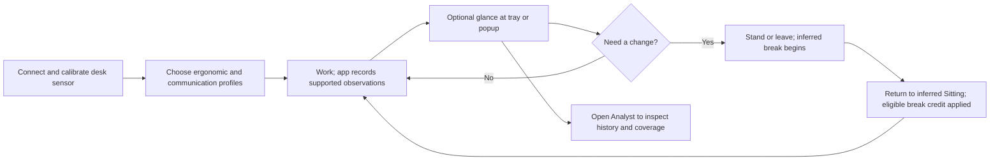

# MoveUp user experience

Part of the product document set: [Purpose and users](PURPOSE.md) · [Vision](VISION.md) · [Design contract](../DESIGN.md). Updated 2026-10-27. This document distinguishes current source behavior from proposed improvements; it does not certify every flow on a running installation.

## Experience principles

- Lead with the decision the person needs now: understand the sitting balance and decide whether to change position or take a break.
- Separate a recorded desk-state estimate, input inactivity, credited balance and motivational score. None independently proves physical posture or exercise.
- Explain numbers at the point of use. A large counter needs a name; a colored history needs a legend and time scope.
- Preserve recorded history. Break credit changes the current balance, not historical elapsed time. Unknown time is never manufactured Away.
- Keep background operation quiet. Opening a popup is optional; leaving the desk should not require managing the application.
- Show recording quality separately from whether the view recently refreshed. A working counter does not prove that a WebView paints or that history is complete.
- Keep the 420×240 popup useful. Use the existing charcoal/monospace system and put detailed diagnostics and secondary metrics behind explicit disclosure or Analyst.

## Current core flow

Source references: `src/App.tsx`, `src/widgets/OneBarWidget.tsx`, `src/widgets/one-bar/OneBarTimer.tsx`, `src/widgets/one-bar/OneBarTimeline.tsx`, `src/components/SettingsPanel.tsx`, `src/analyst/AnalystWindow.tsx`, `src-tauri/src/activity.rs`, `src-tauri/src/session_reading.rs`, `src-tauri/src/session_breaks.rs`.

1. **Setup:** attach supported hardware and calibrate sitting/standing desk heights; select profiles. Sensor height describes the desk, not the person. The current welcome explains reminders, but does not teach the credit/history distinction.
2. **Work:** the native tray/overlay provides background signals. Opening the tray popup shows the inferred state, input activity, large counter, daily metrics and compact timeline. The large Sitting counter uses the credited balance, not the duration of the latest uninterrupted sitting interval.
3. **Leave:** after 60 seconds without Windows keyboard/mouse input the candidate is Away, confirmed by coherent sensor readings and at least five actual seconds of debounce. Missing readings do not independently prove Away. During non-Sitting states the large counter changes meaning to break duration.
4. **Return:** fresh input plus a low desk produces a Sitting candidate. After confirmation, an eligible observed break receives the active profile's credit. Ordinary break credit is applied at the transition, so the person should not expect the historical red area to shrink.
5. **Inspect:** the compact timeline uses recorded individual completed intervals. Clicking its background or activating its focused container opens Analyst for the current local day; individual colored segments select interval details. Analyst offers a day timeline, daily composition and expandable score/credit details. Conflicting or invalid history now produces a local error while range/day controls and Retry remain available; selecting a clean range recovers the view without reloading. Failed/loading history does not produce a successful zero or empty composition. Ongoing-observation/freshness work has a separate existing delivery owner; proposed or parked source is not installed behavior.
6. **Configure:** gear or tray Settings opens the same main window. Profiles and timeline skin currently apply immediately; calibration/other settings use Save. This mixed model needs clearer feedback. Do not change settings while investigating a historical discrepancy.
7. **Share:** explicit Share opens a bounded modal with four statistics and Copy/X/Reddit actions. External sharing remains user initiated.
8. **Investigate a failure:** native Save UI diagnostics can collect local window evidence even if the main React view is unusable. Unknown cause remains unknown; diagnostics do not automatically reload/restart the app.

## AI-assisted and low-input journeys

| Situation | What current signals establish | Current limitation | Proposed experience |
|---|---|---|---|
| Seated and reading an AI answer for several minutes | Low desk, no recent keyboard/mouse input | Can become Away and receive break credit despite the person remaining seated | Say input inactivity / estimated absence and explain uncertainty; decide on a presence policy before changing credit |
| Listening or speaking to AI while at the desk | Same limited height/input evidence | Voice activity is not currently posture/presence evidence | Preserve the same uncertainty; do not interpret spoken notes as engine measurements |
| Working with AI while physically away from the computer | No input at the desk, if app/sensor still supply observations | Absence is inferred, not directly measured | Quiet automatic credit under the chosen policy, with an explanation available on return |
| An agent operates native Windows controls while the person is elsewhere | Recent input events may exist without human presence | Input-generating automation could maintain Sitting/Standing; behavior of a particular tool is unverified | Explain the signal's source limitations and verify this scenario before choosing a presence policy |
| Computer asleep, app stopped or sensor silent | No supported posture observation during the gap | Cannot establish that the gap was Sitting, Away or movement | Show Unknown, retain earlier known history; make any retained balance and lack of automatic credit explicit |

## Proposed popup hierarchy

**Proposal for review, not an accepted visual or algorithm change.** Keep one focal number and the current native size. The existing DESIGN remains authoritative until a design decision is accepted.

1. **Current estimate and recording quality:** state/height plus a concise, source-qualified freshness/uncertainty indication. Exact causes/times belong in accessible details.
2. **Named sitting balance:** `Sitting balance 52 min / 40 min` and separately `12 min over your limit`; avoid prefixing the full 52 minutes with a misleading plus. While breaking: `Break 4 min` plus `Estimated credit 8 min; applied when you return` in a 2:1 example, only when the producer supports that provisional calculation.
3. **One understandable next action/message:** a quiet suggestion based on the effective existing policy, rather than more alarming metrics. No invented health advice or automatic new notification channel.
4. **History:** label it `Recorded desk history today`; provide readable state names, Unknown and time scope. Activating the history should make the route to the same day in Analyst discoverable.
5. **Details:** daily metrics, score explanation and Share remain secondary. Preserve explicit Settings access and existing complete Share modal behavior.

Example values above are illustrative, not the owner's captured day or prescribed limits.

## Required states and acceptance scenarios for future changes

| Scenario | Required behavior | Status of this document |
|---|---|---|
| First launch, no observations | Explain setup/recording status, not successful zero history | Target; rendered flow not certified |
| Current supported Sitting span, no completed session yet | Producer-qualified current history, never a fabricated interval to browser Now | Existing accepted direction; delivery must be verified separately |
| Supported break shorter than active minimum | Explain no credit; preserve real recorded duration | Existing algorithm contract |
| Qualifying break and return | Show effective multiplier, observed duration, balance before/credit/after in accessible details | Existing calculation; explanation proposed |
| Balance exceeds limit | Clearly distinguish balance from overtime | Confirmed source presentation issue; correction proposed |
| Reading/listening with no input | Do not assert measured physical absence | Product-policy decision pending |
| Sleep, stopped app, disconnected/stale sensor | Unknown coverage, no guessed history/credit, retain known prefix | Existing truthful-observation contract |
| View query fails | Retain data with explicit stale/error status and a recovery route | Existing accepted direction; popup exposure needs verification |
| Analyst history conflicts or has invalid endpoints | Localized error, preserved navigation/Retry, clean-range recovery without reload; no fabricated successful composition | Delivered 2026-10-27; focused actual-App regression and native conflict/clean recovery verified |
| Settings fail to load | Visible failure and Retry, no editable default masquerading as loaded configuration | Proposed correction |
| Invalid calibration corrected | Error clears and Save becomes available | Proposed regression/correction |
| Keyboard navigation, enlarged text | Reachable named controls, visible focus, contained overlays; ordinary Share fits without scroll | Share already verified; broader surfaces require scoped checks |

## Open product decisions

- Whether and how to supplement the input-inactivity heuristic for reading, voice/AI work and genuine absence. A manual override, longer threshold and added presence hardware have different costs; no new sensor or mode is selected here.
- Whether native-input automation is relevant to the owner's work. Verify the actual tool path without assuming terminal output or browser events count as Windows input; do not label all agent activity as a person's presence.
- Whether the owner wants explicit restoration credit during *unobserved* downtime. Current direction forbids inventing observed Away; any future rule must remain separate from the historical evidence and preserve provenance.
- Which daily metrics help the person's next decision in the compact popup; move secondary explanation to Analyst without deleting useful recorded data.

The private dated UX audit holds evidence, prioritized recommendations and acceptance checks. A recommendation is not implementation authority. No algorithm, setting, stored history or installed application was changed by this documentation work.
