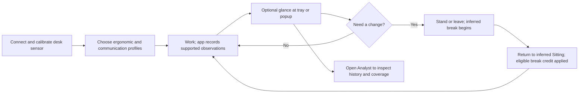

# MoveUp user experience

Part of the product document set: [Purpose, working personas and goals](PURPOSE.md) · [Vision](VISION.md) · [Design contract](../DESIGN.md). Updated 2026-10-29.

The owner accepted all ten whole-product UX outcomes on 2026-10-28. This document describes that accepted experience and the implementation being prepared for release. The [delivery record](epics/E031-2026-10-28-whole-product-ux/PRES.md) distinguishes reviewed source, executed tests, rendered images, a successful build and the installed Windows result. Describing a candidate flow here does not certify its deployment. Remaining recovery corrections and final verification stay open in that record.

## Experience principles

- Lead with the decision the person needs now: understand the sitting balance and decide whether to change position or take a break.
- Separate a recorded desk-state estimate, input inactivity, credited balance and motivational score. None independently proves physical posture or exercise.
- Explain numbers at the point of use. A large counter needs a name; a colored history needs a legend and time scope.
- Preserve recorded history. Break credit changes the current balance, not historical elapsed time. Unknown time is never manufactured Away.
- Keep background operation quiet. Opening a popup is optional; leaving the desk should not require managing the application.
- Show recording quality separately from whether the view recently refreshed. A working counter does not prove that a WebView paints or that history is complete.
- Keep the 420×240 popup useful. Use the existing charcoal/monospace system and put detailed diagnostics and secondary metrics behind explicit disclosure or Analyst.

## Accepted core flow

Source references: `src/App.tsx`, `src/widgets/OneBarWidget.tsx`, `src/widgets/one-bar/OneBarTimer.tsx`, `src/widgets/one-bar/OneBarTimeline.tsx`, `src/components/SettingsPanel.tsx`, `src/analyst/AnalystWindow.tsx`, `src-tauri/src/activity.rs`, `src-tauri/src/session_reading.rs`, `src-tauri/src/session_breaks.rs`.

1. **Setup:** the first-run guide distinguishes a detected USB controller from a working sensor, asks the person to confirm a changing height, and points to the real calibration inputs. Height describes the desk, not the person. Missing observations remain Unknown. **Open MoveUp** explicitly shows/focuses the existing main window while preserving its current view and protected work; it does not assert that setup succeeded. Known activation or preference-save failures remain visible and retryable in the guide.
2. **Work:** tray/overlay signals remain in the background. The popup leads with **Sitting balance / configured limit**, separate **Over limit**, and an **Estimated**, **Last estimate** or **Unknown** desk state. A failed view refresh is distinct from a stale sensor observation. The disclosure explains source times, input limitations and the history/balance distinction. The optional input label says **Recent input** or **No recent input**; it is not a human-presence measurement.
3. **Leave or work without input:** the Windows activity adapter uses 60 seconds without input to produce an inactive candidate; coherent readings and at least five actual seconds of debounce confirm a state transition. The input label changes after 30 seconds, so its display threshold is separate from Away classification. Reading, listening, thinking or AI work can produce low input while the person remains at the desk. Missing readings do not independently prove Away. During a non-Sitting state the large counter explicitly names break duration.
4. **Return and understand credit:** confirmed fresh input and a low desk can return the estimate to Sitting. An observed break below the active minimum receives no credit. A qualifying break uses the engine's multiplier, bounded to 0–10; previously credited parts of the same break are not credited twice, and the applied reduction cannot exceed the outstanding balance. The last-break disclosure shows captured duration, minimum, multiplier, prior/applied credit and before/after balance for actual applications. Missing legacy facts remain unavailable. It does not recompute old credit from today's profile. Recorded red intervals retain their elapsed duration.
5. **Inspect:** explicit **Today** and the existing compact-timeline activation open Analyst for the current local day; individual segments retain their details. A day request must be saved successfully before opening, and failures must be visible and retryable. Analyst retains the chosen range, extends it only as needed for Today, compares preset endpoints with the actual recent dates, and names the **From**/**To** fields separately. It combines completed history with producer-qualified ongoing observations, ending at the confirmed horizon. Local data errors retain navigation and Retry; clean-range recovery does not reload the app. Unknown/Future and instant-only readings remain explained through accessible details.
6. **Configure:** gear or tray Settings uses the main window. Profile/theme choices apply immediately; Back does not undo them. Calibration and other Save-based values remain drafts until Save. Failed loads show Retry and disabled Save, and corrected validation recovers without discarding the draft. Current rules come from the live session/policy, with runtime overrides distinguished from profile values. A successful switch followed by a failed metadata read shows unavailability and a read-only retry. Pending reads and profile mutations are serialized. The saved activity preference controls only the input label. Settings tabs use roving focus and manual activation: arrows/Home/End move focus, Enter/Space selects the linked panel.
7. **Share and optional Health:** Share keeps four full statistics, a bounded native modal and reachable Copy/X/Reddit actions. Copy success requires an actual successful copy path; failure has a visible cue, Retry and selectable manual text. A refused protected close must retain the dialog and expose its error inside it. External sharing remains user initiated. Unconfigured Health does not occupy the daily strip; configured readings/errors remain available, and optional setup/data guides are reachable from More.
8. **Investigate a failure:** native Save UI diagnostics can collect local window evidence even if the main React view is unusable. Unknown cause remains unknown; diagnostics do not automatically reload/restart the app.

Optional phone access is a separate journey through **Settings → More → Remote access**. Loading, unavailable, genuine disabled and connected relay states remain distinct; a failed phone-list read is not an empty list. LAN configuration, desk-to-relay connection and telemetry are explained separately. The current source cannot certify the LAN listener/address, a phone connection or firewall reachability. Telemetry is off by default and this build prepares/logs an aggregate locally without uploading it. These explanations do not change network defaults or require cloud setup for desk tracking.

## Reminder flow and evidence

Normal reminders use a persistent message view in the existing main popup, with information/warning/urgent/success category surfaces. They replace ordinary status content while active; protected Settings and Share flows defer presentation. Close and Dismiss acknowledge through the same existing policy path; Snooze uses the configured duration. These controls do not establish that the person took a break. The automatic native show path is non-activating, and ordinary focus loss retains an active reminder. A manual tray action focuses a visible unfocused reminder.

Settings → Notif. offers a test appearance selector and Test reminder. A test leaves the ergonomic session unchanged, shares a 60-second limiter and may be queued until the person returns to status. Queued feedback does not prove that the selected test is already on screen. An older current reminder can remain ahead of the pending preview.

Actual Windows images confirm the ordinary-size status, real urgent reminder, information/warning previews, Settings and Share, plus the current saturated top bar. Initial automatic focus behavior, authoritative effect of the one real Dismiss attempt, Success/test-Urgent native presentation and enlarged native contexts remain incompletely observed. Browser/source verification is separate from this partial native acceptance.

That paragraph records the 2026-10-28 installed baseline. The new candidate additionally reads policy-owned action timing when a real reminder opens and labels that snapshot **At opening**. Snooze waits the actionable current delay without advancing the Dismiss cursor. Dismiss/Close waits the current delay and advances the cursor for future dismissals; the final delay repeats. Unsupported or unavailable timing is explicit. A preview closes without changing the session or real reminder policy. The final candidate's build and Windows acceptance remain in the delivery record above.

## Accepted journey map

These journeys serve the accepted vision of understandable, quiet motivation. The personas and their evidence are defined in PURPOSE; AI/low-input work is a context across them. Their implementation does not change presence or credit policy. Delivery status belongs to the linked delivery record, rather than this journey map.

| Journey and user goal | Route | Accepted response | Acceptance observation |
|---|---|---|---|
| First useful day: recognize actual recording | First-run guide → real reading → calibration/profiles → status | Explain controller, sensor and estimate separately; open the existing main view and offer source-backed help | The person recognizes actual recording or its missing prerequisite without editing JSON |
| Daily glance: decide whether to move | Work → tray or top bar → status | Named balance/limit, separate overtime, estimated state and readable freshness | The person identifies what the number measures and whether the observation is current |
| Low-input work: continue reading/listening | Continue work without input → possible inferred Away → status details | Explain input inactivity and uncertainty at the point of use | The person does not mistake estimated Away for measured physical absence |
| Break and return: understand the benefit | Stand/leave → confirmed non-Sitting → return → credit details | Show captured duration/rule/actual reduction and preserve raw history | The person explains why credit was applied, capped or unavailable without expecting old red intervals to disappear |
| Reminder: choose a response without losing work | Policy cue → main message → Snooze/Dismiss/Close → status | Show policy-sourced timing and current-versus-future consequences; protect ongoing Settings/Share work | The person knows the displayed delay and understands that acknowledgement does not record movement |
| History: explain this day or an unexpected number | Today or compact timeline → selected Analyst day → interval/coverage details | Preserve retained ranges, explicit local-day requests, honest presets and labelled dates | The person finds Today from an old range and can inspect the relevant interval or Unknown coverage |
| Configuration: change one thing predictably | Gear → keyboard-operable sections → Back or Save | Separate immediate changes from drafts; recover load/validation/profile reads truthfully | The person predicts what is applied and recovers without false defaults, stale rules or reapplying a successful switch |
| Recovery: discover what stopped working | Recording/view status → details or tray Save UI diagnostics → local report | Separate observation quality from view receipt; keep known data and bounded evidence | The person sees the actual failure/unavailability and a usable retry without automatic reload |
| Optional sharing and phone use | Share → Copy/X/Reddit; More → Health help or Remote access | Visible copy failure/manual recovery, reachable guides, distinct LAN/relay/telemetry states | The person recovers a failed copy and understands supported visibility before enabling or sharing |

Recommended validation uses concrete tasks: explain a 52-minute balance against a 40-minute limit; explain credit after an observed eligible break; find today's history from a retained old range; recover a failed Settings load; correct invalid calibration; preview a reminder and return to status; and explain who can view the network display. Use synthetic fixtures for failures and accounting rather than editing live history or changing the owner's settings for an audit.

## AI-assisted and low-input journeys

| Situation | What current signals establish | Current limitation | Accepted explanation and remaining policy choice |
|---|---|---|---|
| Seated and reading an AI answer for several minutes | Low desk, no recent keyboard/mouse input | Can become Away and receive break credit despite the person remaining seated | Say input inactivity / estimated absence and explain uncertainty; decide on a presence policy before changing credit |
| Listening or speaking to AI while at the desk | Same limited height/input evidence | Voice activity is not currently posture/presence evidence | Preserve the same uncertainty; do not interpret spoken notes as engine measurements |
| Working with AI while physically away from the computer | No input at the desk, if app/sensor still supply observations | Absence is inferred, not directly measured | Quiet automatic credit under the chosen policy, with an explanation available on return |
| An agent operates native Windows controls while the person is elsewhere | Recent input events may exist without human presence | Input-generating automation could maintain Sitting/Standing; behavior of a particular tool is unverified | Explain the signal's source limitations and verify this scenario before choosing a presence policy |
| Computer asleep, app stopped or sensor silent | No supported posture observation during the gap | Cannot establish that the gap was Sitting, Away or movement | Show Unknown, retain earlier known history; make any retained balance and lack of automatic credit explicit |

## Accepted popup hierarchy

Keep one focal number and the current native size. These refinements were accepted with the ten outcomes; DESIGN remains the visual authority. They preserve the existing algorithm.

1. **Current estimate and recording quality:** state/height plus a concise, source-qualified freshness/uncertainty indication. Exact causes/times belong in accessible details.
2. **Named sitting balance:** `Sitting balance 52 min / 40 min` and separately `12 min over your limit`. While breaking, explicitly name elapsed break time. Credit details describe actual captured applications; an unconfirmed provisional reduction is not presented as already applied.
3. **One understandable next action/message:** a quiet suggestion based on the effective existing policy, rather than more alarming metrics. No invented health advice or automatic new notification channel.
4. **History:** label it `Recorded desk history today`; provide readable state names, Unknown and time scope. Activating the history should make the route to the same day in Analyst discoverable.
5. **Details:** daily metrics, score explanation and Share remain secondary. Preserve explicit Settings access and existing complete Share modal behavior.

Example values above are illustrative, not the owner's captured day or prescribed limits.

## Required states and acceptance scenarios

This is a behavior contract, not a table of completed tests. Actual results and missing Windows evidence stay in the delivery record.

| Scenario | Required behavior |
|---|---|
| First launch, no observations | Explain setup/recording status and preserve a retryable guide; do not imply successful recording |
| Current supported Sitting span, no completed session yet | Render producer-qualified current history, without extending coverage to an unsupported browser Now |
| Supported break shorter than active minimum | Explain no credit and preserve real recorded duration |
| Qualifying break and return | Expose captured duration, minimum, multiplier, prior/applied credit and before/after balance |
| Balance exceeds limit | Clearly distinguish the whole balance from actual overtime |
| Reading/listening with no input | Explain the heuristic without claiming measured physical absence; a new presence policy remains a separate decision |
| Sleep, stopped app, disconnected/stale sensor | Keep Unknown coverage and the known prefix; do not invent historical posture or credit |
| View query fails after a known reading | Keep the last estimate with visible failed-refresh status and distinct observation/response details |
| Analyst history conflicts or has invalid endpoints | Localize the error, preserve navigation/Retry and recover through a clean range without reload or false successful composition |
| Settings fail to load or corrected calibration is valid | Offer Retry without editable false defaults; clear corrected validation and permit Save |
| A profile applies but its metadata read fails | Preserve the successful choice, suppress unconfirmed rules and offer a read-only retry; old reads cannot overwrite newer operations |
| Today request storage or protected Share close fails | Expose the failure and retry in the current accessible surface; do not open an older day or hide an error behind a modal |
| Clipboard API and fallback both fail | Show immediate failure, reachable retry/manual text, no false Copied state and preserved Share values |
| Keyboard navigation and enlarged text | Keep named controls, visible focus, linked tabs/panels, reachable text and contained overlays; label/input pairs remain understandable |

## Open product decisions

- Whether and how to supplement the input-inactivity heuristic for reading, voice/AI work and genuine absence. A manual override, longer threshold and added presence hardware have different costs; no new sensor or mode is selected here.
- Whether native-input automation is relevant to the owner's work. Verify the actual tool path without assuming terminal output or browser events count as Windows input; do not label all agent activity as a person's presence.
- Whether the owner wants explicit restoration credit during *unobserved* downtime. Current direction forbids inventing observed Away; any future rule must remain separate from the historical evidence and preserve provenance.
- Which daily metrics help the person's next decision in the compact popup; move secondary explanation to Analyst without deleting useful recorded data.

The private dated audit preserves the original findings. The ten accepted outcomes have authority in [VISION](VISION.md) and the [owning plan](epics/E031-2026-10-28-whole-product-ux/PLAN.md); other recommendations remain proposals. This documentation revision changes no algorithm, live setting, stored history or installed application. Native evidence and remaining validation limitations must be kept explicit when the candidate is delivered.
